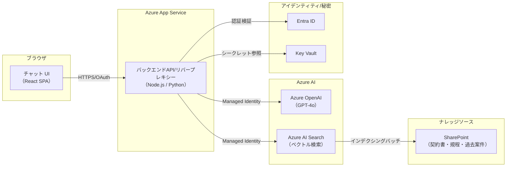

# 設計要件

<!-- 全体構成・コンポーネント選定・構築フェーズは architecture スキル（.github/skills/architecture/SKILL.md）を正とする -->
<!-- 本ドキュメントには architecture スキルの判断フロー・設計アウトプットテンプレートで確定した結果を転記する -->

## 1. 変換対象ファイル

- Batch converted at: `2026-07-14T04:21:25.387065+00:00`
- Files: 1

| Source | Staging markdown | Status | Note |
| --- | --- | --- | --- |
| `20260714_ TMI_調達ナレッジ資産化.pdf` | `20260714_ TMI_調達ナレッジ資産化.pdf.MD` | `completed` | Microsoft Japan 提案資料（調達ナレッジ資産化・AI活用構想） |

## 2. 全体構成案

ユーザーのAzure App Serviceデプロイ指定に基づき、Power Platformではなく **Azure リファレンスアーキテクチャ**（`.github/skills/azure/references/foundry-agent.md` の「Webサイト組み込み型AIエージェント」パターン）を採用する。初期PoCの対象テーマは「調達FAQ・ナレッジ検索（＋過去案件検索）」とし、RAG（Retrieval-Augmented Generation）方式のチャット検索アプリとして実装する。

> Foundry IQ / Work IQ / Fabric IQへの拡張は将来フェーズ（中長期）の候補とし、PoC段階では Azure OpenAI + Azure AI Search の最小構成で開始する（[foundry-agent.md §3](../../../.github/skills/azure/references/foundry-agent.md#3-知識グラウンディング-work-iq--foundry-iq--fabric-iq)）。

## 3. コンポーネント設計

| コンポーネント | 種別 | 役割 | 依存 | 備考 |
| --- | --- | --- | --- | --- |
| Azure App Service (Web App) | チャットUI + APIバックエンド | 人向けUI・入力受付のセット | Entra ID、Azure OpenAI、Azure AI Search | Managed Identityを作成時に指定 |
| Azure OpenAI | AIモデル | 回答生成（GPT-4o 等） | なし | 公衆ネットワークアクセス制限は組織ポリシーに従う |
| Azure AI Search | 検索エンジン | ナレッジのインデックス化・ベクトル検索 | なし | キー認証ではなくManaged Identity接続を基本とする |
| Entra ID | 認証・認可 | 利用者（調達室担当者）のシングルサインイン認証 | なし | App Service の認証機能（Easy Auth）を利用 |
| Key Vault | 秘密管理 | 接続文字列等の秘密保持（可能な限りManaged Identityを優先） | なし | コンテナに秘密を埋めない |
| （将来）SharePoint / Microsoft Graph | ナレッジソース | 契約書・規程・過去案件資料の取得元 | Azure AI Search のインデックス化 | PoCの初期データ取込は手作業アップロードで代替可 |

## 4. セキュリティ / 権限 / 監査

| 区分 | 内容 | 対応方針 |
| --- | --- | --- |
| 認証 / 認可 | アプリ利用者のEntra ID認証 | App Service 認証（Easy Auth）+ テナント内ユーザーのみ許可 |
| コンポーネント間認証 | App Service → Azure OpenAI / Azure AI Search | **Managed Identity**（キー認証不使用） |
| データアクセス制御 | 検索対象フィールドのアクセス制御 | RBAC最小権限、バックオフィスサービスとの連携は将来検討 |
| ガバナンス/ハルシネーション対策 | プロンプトインジェクション対策 | システムプロンプトで回答対象をナレッジベースに限定、Azure AI Content Safety の導入は将来検討 |
| 監査ログ | 利用履歴の記録 | Application Insights でリクエスト/トークン使用量を可視化 |
| テナントポリシー | 公衆ネットワークアクセス禁止・共有キー禁止・MFA必須等の制約 | 組織の強制ポリシーと戦わず準拠する構成を採用（Private Link・Managed Identity）。対象リソースグループの強制ポリシーは実装前に要確認 |

## 5. 設計上のリスク

| # | リスク | 影響度 | 発生確率 | 対応方針 |
| --- | --- | --- | --- | --- |
| 1 | 初期PoCではナレッジソース（契約書等）の自動取込が未整備のため、サンプルデータでの検証に限定される | 中 | 高 | 初期は手動アップロード用スクリプトで対応し、本番化時にSharePoint連携を追加 |
| 2 | Azure OpenAI / Azure AI Search のリソースリージョン・クォータが未確定 | 中 | 中 | 実装前にユーザー・Azureテナント側と確認（未確定事項 #4） |
| 3 | 回答の広範囲化（ナレッジにない内容をAIが推測して回答） | 高 | 中 | 必ず出典を提示し、検索ヒットがない場合は「情報がない」と回答するようプロンプトで制御 |
| 4 | 本アプリはPoC位置付けであり、本番運用はお客様/パートナーが担当（資料の前提） | 中 | 高 | 引き渡し手順・IaC（Bicep）を整備し、本番化を容易にする |

## 6. Phase 1 確認事項

- Azure サブスクリプション・リソースグループ・リージョンの確定（[未確定 #4](business-requirements.md#6-未確定事項--要確認事項)）
- PoCで使用するサンプルナレッジデータ（FAQ・規程・過去案件要約）の準備方法
- App Service の認証方式（Entra ID）の対象ユーザーグループ確定

## 7. 実装タスク分解

| # | タスク | 依存タスク | 優先度 | 見積 (h) | 担当 |
| --- | --- | --- | --- | --- | --- |
| 1 | Azureリソース設計・IaC（Bicep）作成（App Service・Azure OpenAI・Azure AI Search・Key Vault） | なし | 高 | 8 | 要確認 |
| 2 | サンプルナレッジデータ作成・Azure AI Search インデックシング | 1 | 高 | 4 | 要確認 |
| 3 | バックエンドAPI実装（RAGパイプライン・Managed Identity接続） | 2 | 高 | 12 | 要確認 |
| 4 | チャットUI（React）実装 | 3 | 高 | 8 | 要確認 |
| 5 | Entra ID認証統合（App Service Easy Auth） | 3 | 中 | 4 | 要確認 |
| 6 | App Service へのデプロイ・CI/CD構築 | 3,4 | 中 | 4 | 要確認 |
| 7 | 検証（回答品質・セキュリティ確認） | 6 | 中 | 4 | 要確認 |

## 8. 備考

- `spec/output/staging/` の markdown を根拠に整理すること
- 情報不足は推測せず `要確認` として残すこと
- 本構成は `.github/skills/azure/references/foundry-agent.md`と`secure-website.md`のパターンを基にする

## 9. 要件変更履歴

- 2026-07-14: Azure App Service + Azure OpenAI + Azure AI Search のRAG構成を確定し初版作成（理由: ユーザーがAzure App Serviceへのデプロイを明示的に指定したため）
